# CollabSpace

A collaboration workspace prototype built with Angular 22: channels, threads, tasks, files and workspace roles in one responsive app.

[](https://angular.dev)
[](https://www.typescriptlang.org)
[](https://vitest.dev)
[](docs/ARCHITECTURE.md#pwa)
[](https://collab-space-frontend-tau.vercel.app/login)
[](docs/FEATURES.md)

**[Live demo](https://collab-space-frontend-tau.vercel.app/login)** · [Screenshots](#screenshots) · [Architecture](docs/ARCHITECTURE.md) · [Feature status](docs/FEATURES.md) · [GitHub](https://github.com/ak-ak-k/CollabSpace-Frontend)

> [!NOTE]
> CollabSpace is a **frontend prototype**. Everything runs in the browser on built-in demo data. There is no backend, real authentication, persistence or real-time server yet, and changes reset when the page reloads.

## Overview

CollabSpace is an independent personal project. It explores how a team workspace in the style of Slack or Microsoft Teams can be built as a production-sized Angular application. Conversations, tasks and files live in one workspace and link to each other:

- a file shows every message and task it was shared in;
- a task attachment is saved to Files;
- every change lands in one activity stream.

The app is fully navigable in the demo workspace "Northstar Labs". It covers 15 feature areas built from 262 standalone components, with a data layer shaped like an API so that a real backend can replace the mock services without touching the screens.

## Why CollabSpace?

- **The problem:** team work is split between chat, a task tracker and file storage, so context gets lost between them.
- **The approach:** one workspace where people, conversations, tasks and files reference each other, with roles that decide who can do what.
- **As an Angular showcase:** it shows modern Angular at scale:
  - standalone components and zoneless change detection;
  - signals for all state;
  - Signal Forms;
  - lazy routes with functional guards;
  - Angular CDK overlays and drag and drop;
  - a token-based design system;
  - a service-worker PWA;
  - an accessibility target of WCAG 2.2 AA.

## Try the demo

1. Open the [live demo](https://collab-space-frontend-tau.vercel.app/login). A first visit opens the demo workspace directly, because the session is simulated.
2. To see the login screen, choose **Sign out** in the account menu (the avatar at the bottom of the rail).
3. The login and signup forms check the input: a valid email, and a password of at least 8 characters. They then open the same demo workspace. No account is created and nothing is sent to a server.
4. Switch workspace from the tile at the top of the rail to see other roles: **Orbit Studio** as an Admin, **Kite Ventures** as a Guest.
5. Choose **Simulate offline** in the account menu to try queued messages and the sync states.

All people, teams, messages, tasks and files are fictional demo data.

## Features

Status labels for every feature are in [docs/FEATURES.md](docs/FEATURES.md).

| Area                           | What you can do                                                                                                                                                                                                                                                                                                                                                                      |
| ------------------------------ | ------------------------------------------------------------------------------------------------------------------------------------------------------------------------------------------------------------------------------------------------------------------------------------------------------------------------------------------------------------------------------------ |
| **Messaging**                  | <ul><li>Channels, direct messages and group chats, with threads and per-thread unread counts.</li><li>Reactions, pins and saved messages; edit and delete with Undo.</li><li>Mentions of people, `@here` and `#channel`; bold, italic and code formatting.</li><li>Typing indicators, deep links to a message or thread, and replies that a simulated teammate sends back.</li></ul> |
| **Teams and channels**         | Team directory, public and private teams, team roles (Owner, Admin, Member), channel create, edit and archive, and a notification level per conversation                                                                                                                                                                                                                             |
| **Tasks**                      | <ul><li>Kanban board with drag and drop, keyboard moves and a Move to menu; list view; filters.</li><li>Task details with subtasks, comments, attachments and an activity timeline.</li><li>Links of the form `/tasks/NS-142`.</li></ul>                                                                                                                                             |
| **Files**                      | Recent, shared, personal and starred views; simulated upload progress; preview; rename; delete with Undo; "Shared in" links back to messages and tasks                                                                                                                                                                                                                               |
| **People**                     | Directory with team and department filters, presence states, a profile side panel and full profiles                                                                                                                                                                                                                                                                                  |
| **Workspace admin**            | <ul><li>Create and switch workspaces; invitations.</li><li>An editable matrix of 13 permissions across Owner, Admin, Member and Guest.</li><li>Ownership transfer, archive, scheduled deletion, and an audit log with previous and new values.</li></ul>                                                                                                                             |
| **Activity and notifications** | Filterable activity feed; notification centre with mention, thread-reply and due-date rules; per-channel mute levels and preferences                                                                                                                                                                                                                                                 |
| **Search**                     | Command palette (Ctrl/Cmd+K or `/`) with scopes, recent searches and full keyboard navigation                                                                                                                                                                                                                                                                                        |
| **Across the app**             | <ul><li>Light, dark and system themes; layouts for desktop, tablet and mobile.</li><li>Contextual 403 and 404 pages.</li><li>Offline network bar with simulated sync; PWA install and update banner.</li></ul>                                                                                                                                                                       |

## Screenshots

These were captured from a local production build, at 1440 × 900 on desktop and 390 × 844 on mobile, using the built-in demo data.

<table>
  <tr>
    <td width="50%">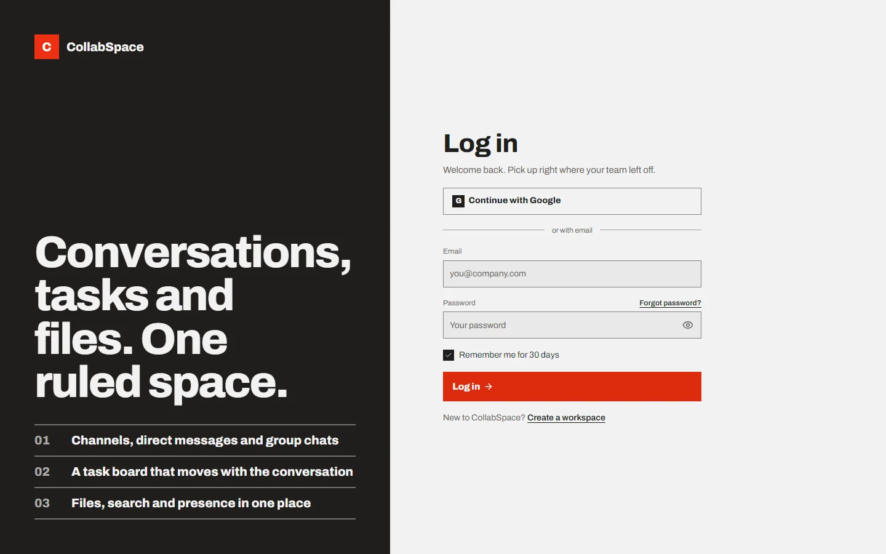<br><sub><b>Login</b></sub></td>
    <td width="50%">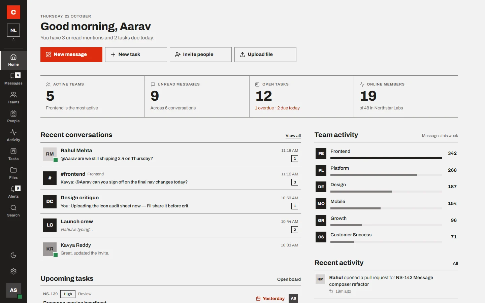<br><sub><b>Dashboard</b></sub></td>
  </tr>
  <tr>
    <td>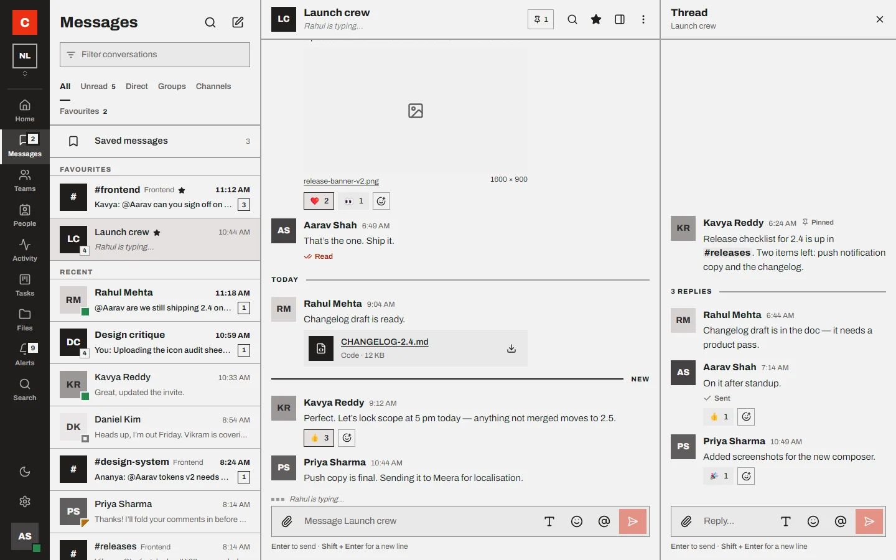<br><sub><b>Messages with a thread open</b></sub></td>
    <td>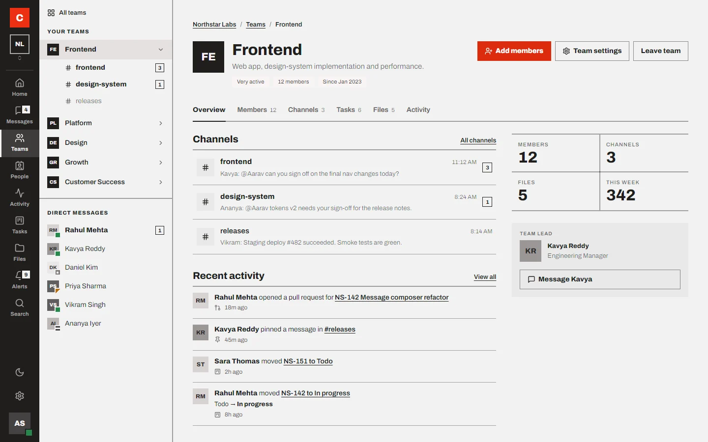<br><sub><b>Team overview</b></sub></td>
  </tr>
  <tr>
    <td>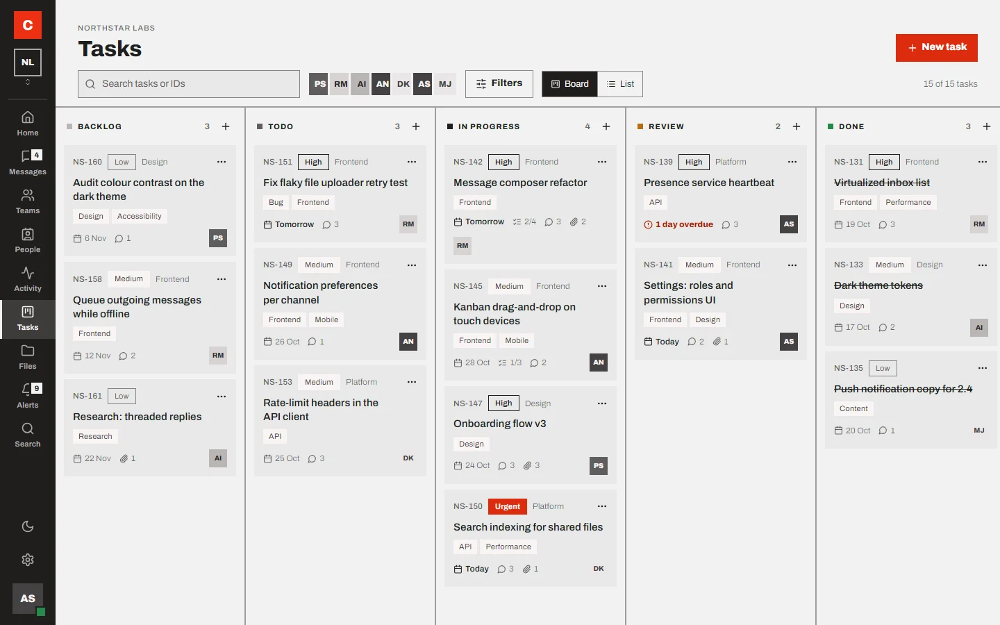<br><sub><b>Task board</b></sub></td>
    <td>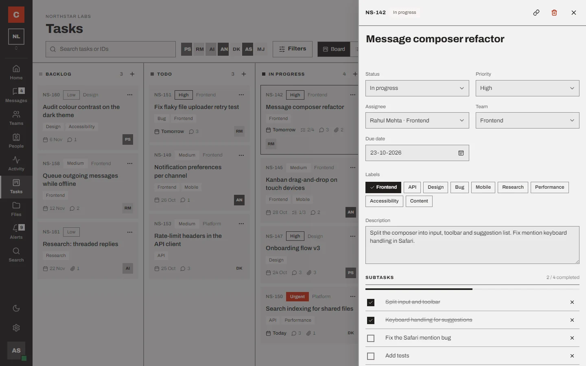<br><sub><b>Task details</b></sub></td>
  </tr>
  <tr>
    <td>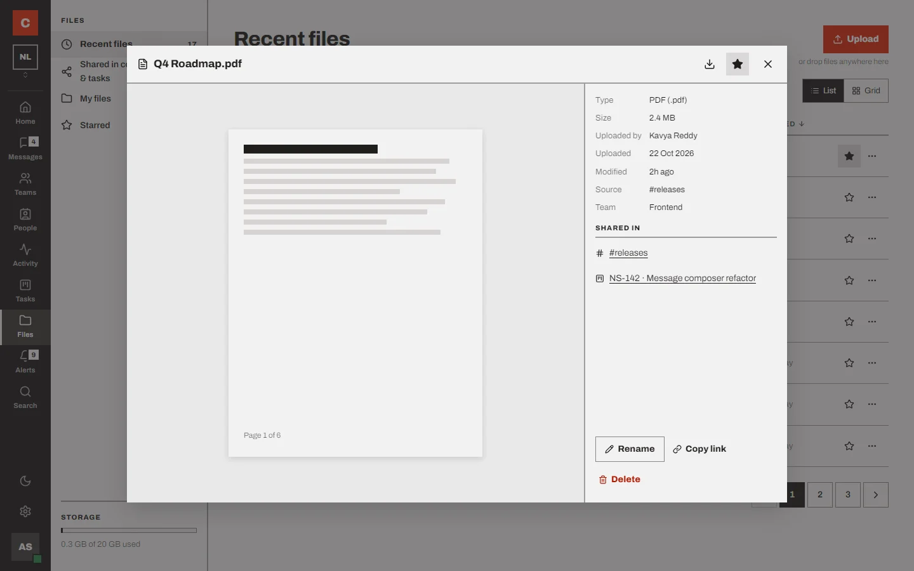<br><sub><b>File preview</b></sub></td>
    <td>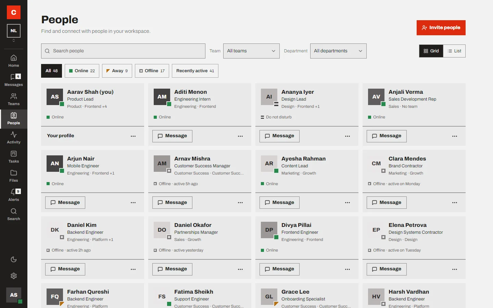<br><sub><b>People directory</b></sub></td>
  </tr>
  <tr>
    <td>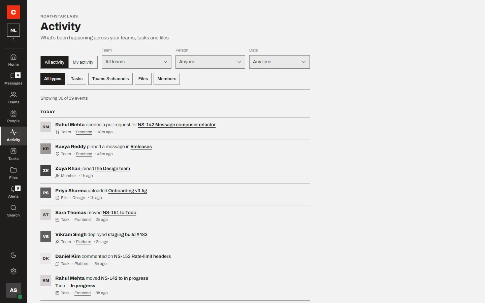<br><sub><b>Activity</b></sub></td>
    <td>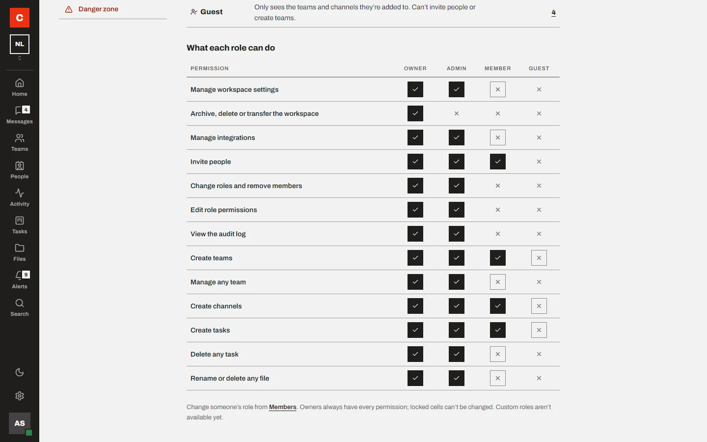<br><sub><b>Roles and permissions</b></sub></td>
  </tr>
  <tr>
    <td>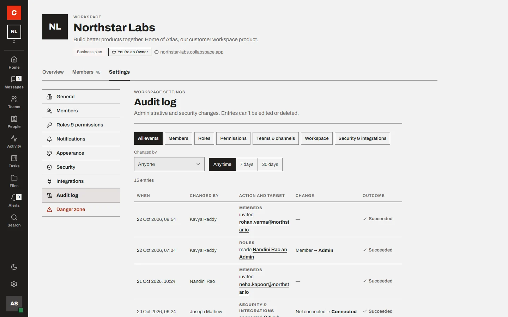<br><sub><b>Audit log</b></sub></td>
    <td>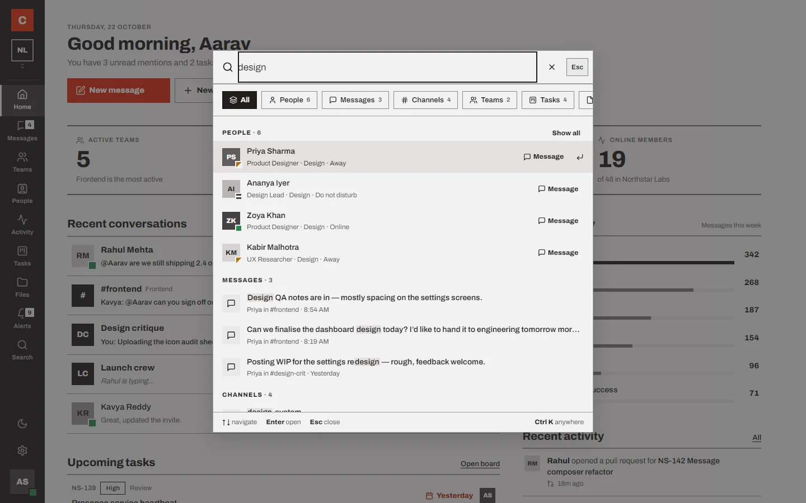<br><sub><b>Search palette</b></sub></td>
  </tr>
  <tr>
    <td colspan="2">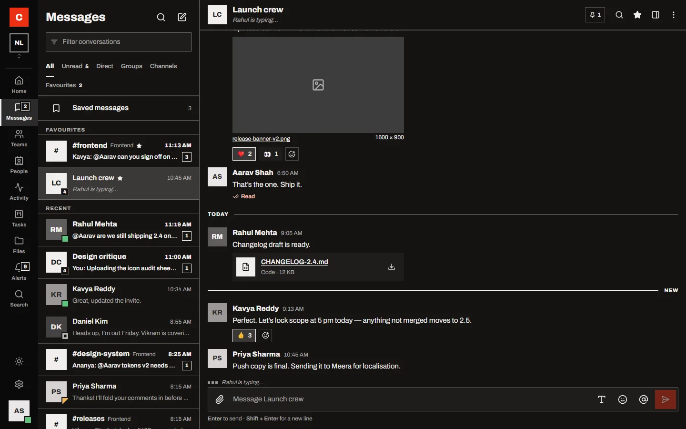<br><sub><b>Dark theme</b></sub></td>
  </tr>
</table>

<p>
  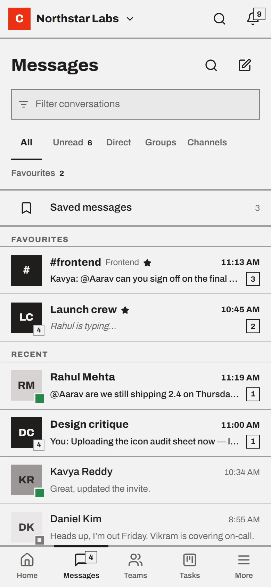
  &nbsp;
  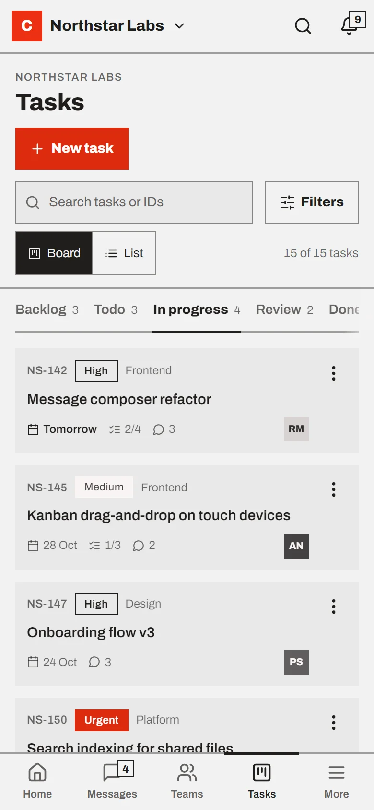
</p>

## Tech stack

| Concern       | Choice                                                                                                                |
| ------------- | --------------------------------------------------------------------------------------------------------------------- |
| Framework     | Angular 22.2: standalone components, zoneless change detection, signals, Signal Forms, lazy routes, functional guards |
| Language      | TypeScript 6.0 in strict mode, with strict templates                                                                  |
| UI primitives | Angular CDK 22.2: dialog, overlay, menu, drag and drop, layout, clipboard                                             |
| Icons         | Lucide Angular                                                                                                        |
| Styling       | SCSS with design tokens as CSS custom properties, breakpoint mixins, light and dark palettes                          |
| Async         | RxJS 7.8, for the simulated real-time event stream and router events                                                  |
| PWA           | `@angular/service-worker`, a web app manifest and maskable icons                                                      |
| Testing       | Vitest 5 with jsdom, through Angular's unit-test builder                                                              |
| Build         | `@angular/build` application builder (esbuild, Vite dev server)                                                       |
| Hosting       | Vercel                                                                                                                |

The app does **not** use NgRx, `HttpClient`, WebSockets or server-side rendering.

## Architecture

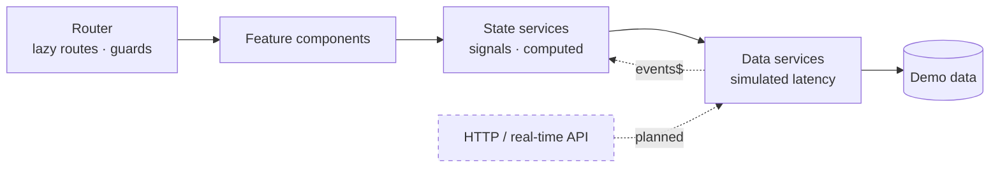

Components read signals from singleton state services marked with `@Service()`. State services load data through a small `Loadable` helper, which publishes a `loading`, `ready`, `empty` or `error` status. Data services return demo data after a 300–600 ms delay. A simulated chat stream (an RxJS `Subject`) drives replies, typing indicators and notifications.

[docs/ARCHITECTURE.md](docs/ARCHITECTURE.md) covers routing, access rules, permissions, offline handling and the PWA in detail.

## Getting started

**Requirements:** Node.js `^22.22.3` or `^24.15.0` (the range Angular 22 requires) and npm. The repository pins npm 11.19.0 through `packageManager`.

```bash
git clone https://github.com/ak-ak-k/CollabSpace-Frontend.git
cd CollabSpace-Frontend
npm ci
npm start
```

Open http://localhost:4200. You start signed in to the demo workspace.

- **Backend:** none needed. All data is bundled demo data.
- **Environment variables:** none. There is no API URL to configure yet.
- **npm 11 warning:** npm 11 may warn that install scripts for `esbuild`, `lmdb`, `msgpackr-extract` and `@parcel/watcher` were not run. The app still builds and serves without them.

### Scripts

| Command                     | What it does                                                                          |
| --------------------------- | ------------------------------------------------------------------------------------- |
| `npm start`                 | Development server with live reload (`ng serve`)                                      |
| `npm run build`             | Production build to `dist/collabspace-frontend/browser`, including the service worker |
| `npm run watch`             | Development build in watch mode                                                       |
| `npm test`                  | Unit tests in watch mode                                                              |
| `npm test -- --watch=false` | Unit tests, single run                                                                |

Development builds also add a "Data state · dev only" section to the account menu. It can force loading, empty or error states and simulate a new app version. There is also a `/styleguide` route listing the UI primitives.

## Project structure

```
src/
├── app/
│   ├── core/            app-wide logic
│   │   ├── data/        mock data services (the future API boundary)
│   │   ├── mocks/       demo data
│   │   ├── models/      types and pure domain rules (permissions, roles, routes)
│   │   ├── state/       signal-based state services
│   │   ├── services/    dialogs, toasts, search, updates, connectivity
│   │   └── guards/      route guards and access rules
│   ├── shared/
│   │   ├── ui/          design-system primitives
│   │   ├── components/  shared composites (message bubble, composer, activity feed…)
│   │   └── pipes/
│   ├── layout/          shell, rail, mobile header, bottom nav, banners
│   └── features/        activity, auth, dashboard, files, messages, notifications,
│                        people, profile, search, settings, styleguide, system,
│                        tasks, teams, workspace
├── assets/              fonts and PWA icons
├── styles/              tokens, breakpoints, touch targets, reset, utilities
├── manifest.webmanifest
└── index.html
ngsw-config.json         service worker caching rules
```

## PWA and offline

|                    | Behaviour                                                                                                                                                                                            |
| ------------------ | ---------------------------------------------------------------------------------------------------------------------------------------------------------------------------------------------------- |
| **Service worker** | Registered in production builds only. It caches the app shell, scripts, styles, fonts and icons, so the app loads with no network. No data or API responses are cached.                              |
| **Manifest**       | Standalone display, standard and maskable icons, and shortcuts to Messages and Tasks.                                                                                                                |
| **Updates**        | Checks every 6 hours and when the tab becomes visible. A banner offers **Reload to update**, which waits for pending offline changes and warns about unsent text.                                    |
| **Install**        | "Install CollabSpace" appears in the account menu when the browser offers installation. iOS Safari gets Add to Home Screen instructions instead.                                                     |
| **Offline mode**   | A network bar shows offline, reconnecting and sync-failed states. Messages, task edits and invitations queue while offline and sync on reconnect; other actions explain that they need a connection. |

What has been verified:

- **Deployed site:** the service worker registers and controls the page.
- **Local production build:** the offline shell loads with the server stopped, and the update banner applies a new version.

**Limitations:**

- Offline queues live in memory, so they are lost if the page reloads while offline.
- Offline detection relies on `navigator.onLine` plus the manual switch.
- The real install prompt has not been tested on physical devices.

## Testing

```bash
npm test -- --watch=false
```

On 22 October 2026: 166 spec files and 600 tests passed. The specs cover state services, domain rules, data services, pipes and shared UI components; feature page components are not unit-tested.

There is no end-to-end suite and no coverage reporting yet. During development, screens were also checked in a headless browser with axe-core (WCAG 2.2 AA rules) at widths from 320 to 1920 px, in light and dark themes. Those scripts are not part of this repository.

## Deployment

The live demo is hosted on Vercel and built with `npm run build`. Direct links such as `/home`, `/activity` and `/tasks/NS-142` load correctly. The Vercel project settings are not stored in this repository.

## Project status

**Frontend prototype.** The v1 screens are complete on demo data and have been through a full browser QA pass covering 10 user journeys. Backend integration is the next phase. Until then, authentication, permissions and persistence are simulated in the browser and must not be treated as security controls.

## Roadmap

Planned, not implemented:

- REST API and real authentication, replacing the mock data services and the simulated session.
- Server-side enforcement of roles, permissions, workspace isolation and private resources.
- Real-time delivery of messages, typing and presence.
- Persistent storage, file uploads with size and type limits, and real downloads.
- A durable offline queue (IndexedDB) with background sync.
- End-to-end tests, linting and continuous integration.

## Author

**Aditya Kirtane**: [github.com/ak-ak-k](https://github.com/ak-ak-k)

This is an independent personal project. It has no production users or commercial deployment.
