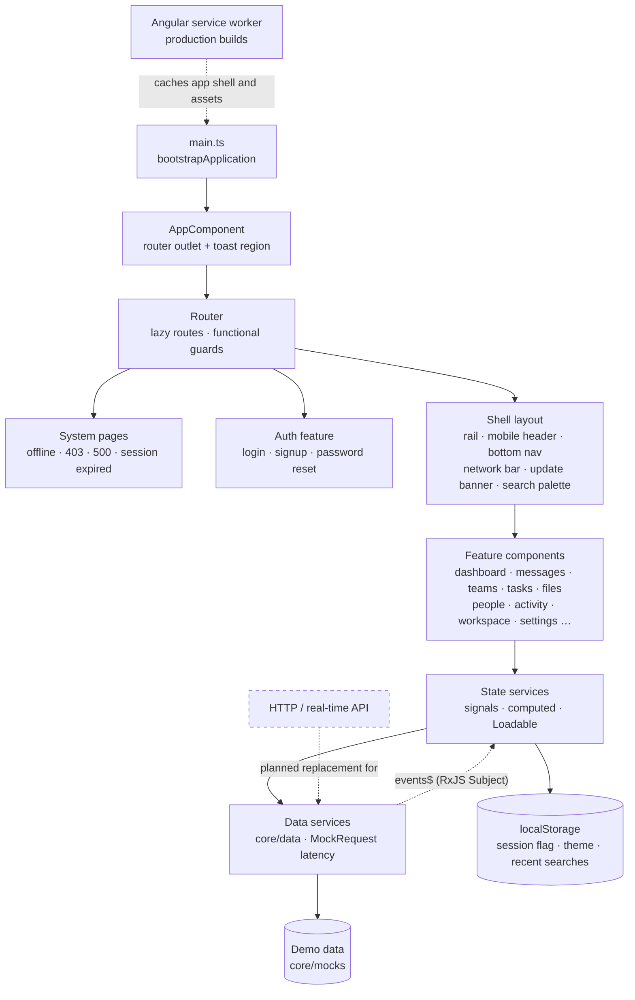

# Architecture

CollabSpace is a single Angular 22 application that runs entirely in the browser. Components read state from signal-based services; those services load and write data through mock data services that stand in for a future HTTP API. There is no backend, no `HttpClient` and no real-time transport in this repository.



## Bootstrap

`src/main.ts` calls `bootstrapApplication(AppComponent, appConfig)`. `app.config.ts` provides:

- `provideBrowserGlobalErrorListeners()`.
- `provideRouter(routes, withComponentInputBinding(), withNavigationErrorHandler(redirectNavigationError))`. Route params arrive as component `input()`s. A failed navigation goes to `/offline` when the browser is offline, otherwise to `/500` with an error reference, and in both cases the original URL stays in the address bar.
- An environment initializer that starts `SessionReturnState`, which remembers the last in-app route for the session-expiry flow.
- `provideServiceWorker('ngsw-worker.js', { enabled: !isDevMode(), registrationStrategy: 'registerWhenStable:30000' })`.

The app is zoneless: there is no `zone.js` dependency, and change detection is driven by signals.

`src/index.html` applies the saved theme before Angular starts, so the page never flashes the wrong theme.

## Routing

`app.routes.ts` defines four top-level groups, in this order:

| Group                                                                                | Loading                                                                                | Guarding                                  |
| ------------------------------------------------------------------------------------ | -------------------------------------------------------------------------------------- | ----------------------------------------- |
| `''` redirects to `/home`                                                            | eager                                                                                  | none                                      |
| System pages (`offline`, `403`, `500`, `session-expired`) in `SystemLayoutComponent` | the offline and 500 pages are eager, so they work even when a lazy chunk fails to load | `signedOutMatch` (signed-out variants)    |
| Auth (`login`, `signup`, `forgot-password`, `reset-password`)                        | lazy `AUTH_ROUTES`                                                                     | `guestGuard` on login and forgot-password |
| Shell with every feature route                                                       | lazy `ShellComponent`, then lazy `*.routes.ts` per feature                             | `authGuard`                               |

There is also a dev-only `/styleguide` (behind `devModeGuard`) and a `**` route for the 404 page.

Fine-grained access is decided while rendering, not in `canActivate`. `RouteAccessState` combines the current URL with workspace, chat and task state. The feature layout then renders a contextual `RouteBlock` page in place of its content: "Team not found", "{Team} is archived", a private channel with Request access, workspace settings for owners and admins only, and so on.

This keeps the URL unchanged, and it re-evaluates immediately when the user switches workspace or their role changes. The pure decision rules live in `core/guards/route-access.ts` and have their own specs.

## Folder organisation

```
src/app/
├── core/          app-wide, framework-agnostic logic
│   ├── data/      mock data services (the future API boundary)
│   ├── mocks/     demo data
│   ├── models/    types and pure domain rules (permissions, roles, routes)
│   ├── state/     signal-based state services
│   ├── services/  dialogs, toasts, breakpoints, search, updates, connectivity
│   └── guards/    functional guards and route-access rules
├── shared/
│   ├── ui/        design-system primitives (button, input, select, tabs, table, dialog, toast…)
│   ├── components/  composite pieces shared by features (message bubble, composer, activity feed, person panel…)
│   └── pipes/
├── layout/        shell, rail, mobile header, bottom nav, drawer menu, banners
└── features/      one folder per product area, each with its own routes file
```

Every component is standalone, lives in its own folder with `.ts`, `.html` and `.scss` files, and uses `input()`, `model()`, `output()` and native control flow (`@if`, `@for`, `@switch`). Forms use Angular Signal Forms (`@angular/forms/signals`).

## Component hierarchy

```
AppComponent
├── <router-outlet>
│   ├── SystemLayoutComponent → offline · 403 · 500 · session expired
│   ├── AuthLayoutComponent → login · signup · forgot · reset
│   └── ShellComponent
│       ├── RailComponent (desktop) · MobileHeaderComponent + BottomNavComponent (mobile)
│       ├── NetworkBarComponent · UpdateBannerComponent · WorkspaceBannerComponent
│       ├── SearchPaletteComponent
│       └── <router-outlet> → feature pages (each lazy-loaded)
└── ToastRegionComponent
```

Dialogs, drawers and bottom sheets are opened through `DialogService`, a thin wrapper over `@angular/cdk/dialog` that adds sizes, side drawers and type-to-confirm prompts. Menus use `@angular/cdk/menu`.

## State management

State lives in plain singleton classes marked with Angular's `@Service()` decorator. There is no NgRx or other store library.

- **Signals:** a service keeps its source data in `signal()`s and exposes derived views with `computed()`. Examples: `WorkspaceState.teams()`, `ChatState.timeline(id)`, `TaskState.tasksForTeam(id)`. `linkedSignal()` is used where a local value must reset when its source changes, such as paging that resets when a filter changes.
- **Loading:** `Loadable<T>` (`core/state/loadable.ts`) wraps a data-service call and publishes a `status` signal: `loading`, `ready`, `empty` or `error`. Screens render skeletons, empty states and error states from that status.
- **Workspace scoping:** most records carry a `workspaceId`. State services filter through `WorkspaceState`, so switching workspace updates every screen at once.
- **Permissions:** `core/models/permission.ts` defines 13 permissions and the default rights of each role. `WorkspaceState.can(permission, resource?)` is the single check used by buttons, menus and route rules. It decides what the UI shows; it is not a security boundary.
- **Activity:** `ActivityLogState` is one append-only event stream. It feeds the Activity page, the audit log, team activity, task history and profile activity, each through a filter.

## Data flow

```
Component → State service → Data service → MockRequest → demo data (core/mocks)
              ↑ signals          (300–600 ms simulated latency)
```

- **Reads:** a state service calls a data service method such as `getTasks()` or `getConversations()`. The data service calls `MockRequest.read()`, which waits 300–600 ms and returns demo data. In development builds, the data-state toggle can force a loading, empty or error result instead.
- **Writes:** writes such as `moveTask()` or `sendMessage()` update the state signal first (optimistic UI), then call the data service. Undo is offered through toasts, and an undo logs the reverse action instead of deleting history.
- **Simulated real time:** `ChatData` exposes an RxJS `Subject` as `events$`. A timer-based simulation (`core/data/chat-simulation.ts`) emits replies, typing and delivery receipts. `ChatState` and the shell's `IncomingAlerts` subscribe to it. `NotificationEngine` decides from the user's preferences, the conversation's mute level and do-not-disturb whether an event becomes a notification or a toast.
- **Swap point:** every data service has plain method names and returns promises or observables. A real API client can replace one without touching components.

## Authentication and session

Authentication is simulated in `AuthState`:

- A boolean flag is kept in `localStorage`. A first visit counts as signed in, so the demo opens directly.
- Login and signup validate their forms, wait about one second, then set the flag. No account is created and no token is issued.
- `authGuard` sends signed-out visitors to `/login?returnUrl=…`. The return URL must be an in-app path.
- Signing out clears recent searches.
- On session expiry, `SessionReturnState` stores the last in-app route in `sessionStorage`, and the next login returns there.

## Offline and connectivity

- **Detection:** `NetworkState` combines `navigator.onLine` with a manual "Simulate offline" switch in the account menu.
- **Queuing and refusals:** while offline, messages, task edits and invitations are queued and marked "Pending sync". Actions that have no queue, such as role changes or deleting a file, are refused by `ConnectionGuard` with an explanation.
- **Reconnecting:** `ConnectionSyncState` shows "Reconnecting…", flushes the queues and reports a summary such as "2 messages sent, 1 task update synced". A development switch can make the sync fail, which brings up the sync-failed bar and Retry.
- **Limits:** the queues live in memory and are lost if the page reloads while offline. There is no IndexedDB storage and no background sync.

## PWA

- **Manifest:** `src/manifest.webmanifest` sets standalone display, 8 standard and 2 maskable icons, and shortcuts to Messages and Tasks.
- **Caching:** `ngsw-config.json` prefetches the app shell, JavaScript, CSS, fonts and icons. Navigation requests fall back to `index.html`. No data or API responses are cached.
- **Updates:** `AppUpdateService` checks for a new version every 6 hours and whenever the tab becomes visible. On `VERSION_READY` it shows the update banner.
  - "Reload to update" waits until no changes are pending sync, and asks for confirmation if any text field still holds unsent text.
  - An unrecoverable service-worker state offers a reload.
- **Install:** `InstallState` captures `beforeinstallprompt` and offers "Install CollabSpace" in the account menu and mobile drawer. It hides the option once the app runs standalone, and shows Add to Home Screen instructions on iOS Safari.

## Error handling and states

- **Navigation errors:** a failed lazy chunk or route goes to the offline page or the 500 page; the 500 page shows a support reference.
- **Data states:** loading, empty, error and offline states come from each feature's `Loadable` status and are rendered with shared `app-skeleton` and `app-empty-state` components.
- **Feedback:** errors and confirmations reach the user through `ToastService`. Toasts are polite live regions and pause while they are hovered or focused.

## Styling and accessibility

- **Tokens:** SCSS design tokens in `src/styles/tokens/` are CSS custom properties covering colour, spacing, type, sizes and z-index. Light and dark palettes swap through the same tokens.
- **Responsive rules:** breakpoint mixins cover mobile (below 768px), tablet (768–1199px) and desktop (1200px and up). Touch mixins guarantee 44px targets on touch devices.
- **Accessibility:** the target is WCAG 2.2 AA, covering labelled controls, visible focus, focus trapping and restoration in dialogs, live regions, keyboard alternatives to drag and drop, and reduced motion. Screens were checked with axe-core in headless Edge during development; those checks are not part of this repository.

## Testing

Unit tests run on Vitest with jsdom through Angular's `@angular/build:unit-test` builder. Specs cover state services, pure domain rules, data services, pipes and shared UI components. Feature page components are deliberately not unit-tested. There is no end-to-end suite and no coverage reporting configured.
